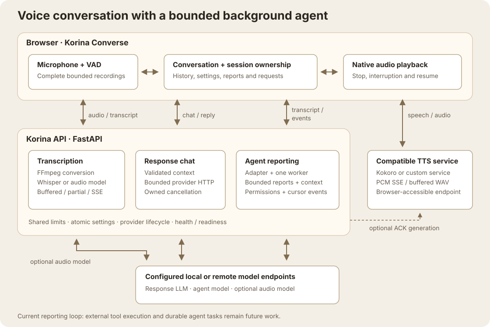

# Architecture

Korina Converse owns the human-facing voice loop. Korina Agent receives bounded conversation snapshots and emits background reports, injection context, or permission requests. The current agent does not execute external tools.

The browser orchestrates voice turns and calls the compatible TTS service directly. The API handles transcription, response-model requests, and agent delivery; the agent returns context and permissions through cursor-based events.

## Boundaries

- `app_factory.create_app()` composes routes, static assets, CORS, request limits, and lifecycle cleanup.
- `routes/stt.py` prepares audio and selects streaming/fallback paths; shared Whisper helpers produce consistent buffered/partial/SSE results. `services/stt_resolution.py` applies one capability-cache and fallback policy to all three paths, avoiding repeated calls to a model already known to reject audio. Blocking model work runs outside the event loop.
- Whisper retains one selected model/device/compute combination. Lazy iterators pin those weights until exhaustion, error, or close; concurrent requests for the same selection share them. A different selection receives a retryable busy response while inference is active, then replaces the idle cached model.
- `services/agent_service.py` owns one worker, one coalesced follow-up prompt, at most five pending injections, and reset generation tokens. Pure context preparation keeps diagnostics identical to the model input. The event ring holds at most 100 whole events and 4 MiB; complete HTTP diagnostics also fit 4 MiB. Admission rechecks the original generation, and failed worker startup permits retry.
- `agents/` defines adapters. `converse/` defines channel registration and cursor-based response delivery. A built-in channel turn requires an idle worker and captures its event cursor atomically; reset or agent off/on cancels its old wait. Duplicate completions carry their own report, and an event-retention gap requires explicit recovery. Legacy HTTP queuing and custom adapter memory retain their separate contracts. Hermes remains a stub.
- `services/provider_manager.py` plans local activation against the actual endpoints used by response, STT, and agent roles. It preserves needed services, validates prerequisites before teardown, rejects protected conflicts, and reports confirmed actions separately from unconfirmed stop requests. Path discovery and executable/socket ownership checks replace personal host assumptions and broad process patterns.
- `runtime/limits.py` resolves shared audio budgets and rejects oversized bodies before request parsing: 2 MiB JSON/control requests and 50 MiB transcription uploads. Schemas also bound fields and conversation turns.
- `tts/` owns optional Kokoro runtime, bounded synthesis admission, and streaming/buffered responses. Request ownership spans model preparation and synthesis. A retired request starts no later native step; per-session advancement/close serialization retains the inference slot until active work and cleanup return. Native inference cannot be force-cancelled.
- `Korina/js/state.js` holds active UI state. `agent-ui.js` is the agent delivery path; a dormant duplicate EventBus was removed.
- `Korina/js/bounded-recorder.js` owns duration/byte limits for complete manual, live, and interruption recordings. Native chunks remain one decodable file. Silent recordings rotate; confirmed speech becomes a complete turn; an oversized or late capture is discarded whole with recovery text.
- `Korina/js/vad.js` samples microphone levels and updates existing waveform bars, changing their count only when the available width changes.
- `Korina/js/sse.js` shares bounded UTF-8/event framing across STT and speech, including CRLF and truncated-stream rejection. `response-body.js` bounds downloaded audio and errors; speech playback validates cumulative PCM duration and native buffered metadata before accepting a long reply.
- `Korina/js/channel-ui.js` owns channel discovery and explicit selection. A rendering generation rejects stale reads; selection disables the control until its save is confirmed. `settings-ui.js` retains re-exports for existing consumers.
- `Korina/js/audio-probes.js` owns probe-cache requests and cache-key normalization. Provider pickers import it directly; `api.js` retains its public re-exports without an API/provider import cycle.
- Probe-cache reads belong to the current picker query, are bounded through body completion, and preserve confirmed warnings on failure. A confirmed Reset releases its control before optional background discovery.
- Optional ACK catalogs are validated once per operation before cache changes. Invalid catalogs leave startup and voice readiness available, with explicit degraded health and unknown clip counts. Voice rebuilds follow successful settings saves; browser ACK status is separate from transcription status.

## Provider transport

`runtime/json_http.py` shares HTTPX/AnyIO transport across model discovery, health, response/agent generation, multimodal transcription, provider status, and ACK downloads. Synchronous callers run in workers; connected I/O is asynchronous under a total network deadline. Successful JSON is capped at 2 MiB, error details at 16 KiB, and ACK WAVs at 2 MiB. Raw identity responses avoid unbounded decompression. Redirects share the deadline and discard unread bodies; credentials and cookies cannot cross origins. Operating-system DNS resolver shutdown remains platform-dependent.

Background agent and ACK requests also carry ownership predicates. A small in-loop watcher closes their connected I/O when reset, shutdown, cache clear, or disable invalidates that owner, freeing the existing worker for fresh work. `runtime/request_owner.py` shares async disconnect ownership across chat and buffered, partial, and SSE transcription, including STT model discovery. Browser disconnect or ASGI cancellation retires connected provider I/O while using the existing pool workers. A retired transcription cannot enter fallback, write an unsupported-model result, start FFmpeg, or advance another native Whisper step. SSE cleanup waits behind an active step before closing its iterator and temporary files. These watchers add no request thread; active decoder/native steps finish under their existing bounds, and connection closure does not establish remote model-compute cancellation.

Clear Session aborts its existing browser chat fetches through response-body completion. Stop Live cancels only its live/interruption chats and capture; a separate typed Ask remains independent. Temporary audio uses a fixed filename and FFmpeg inspects its bytes, so client filenames cannot become filesystem names or mislabel the format.

Blank role credentials inherit response credentials only at the same normalized API base URL. Explicit independent endpoints require explicit credentials. Model refresh merges only its owned settings under shared activation admission, preserving unrelated edits and probe-cache changes.

Explicit probe batches and ordinary STT fallback carry request ownership through provider I/O and cache transactions. Ownership is checked after acquiring the settings lock, so retired work cannot publish a stale unsupported result or clear a newer warning. Disconnect closes connected I/O and prevents later candidates; already-running native work finishes before cleanup.

## Health and readiness

`GET /api/health` remains HTTP 200 for a live backend with unavailable models. Independent provider probes run concurrently; matching endpoint/model/credentials reuse a probe within that request. Runtime blocks describe response LLM, audio-model STT, agent, TTS, Whisper, and ACK state. The three model-role blocks include the actual `models_url` used by their probe, and TTS reports its resolved `health_url` (null when no health contract is configured for a custom service). The Endpoints panel uses these URLs directly, preserving display bases without guessing suffixes.

`GET /api/ready` returns a check map for frontend assets, response LLM, selected STT dependencies, TTS, and enabled agent. It returns 503 when a required check fails. A reachable lazy Kokoro pipeline counts as available; rehearsal must warm actual models.

`asset_manifest.py` declares the required browser filenames once for packaging, runtime readiness, and verification fixtures. Frontend readiness checks every required regular/readable file away from the event loop, including all imported modules; optional ACK/config example data is separate. Custom runtime content remains supported. This verifies file availability, not JavaScript execution, API compatibility, or a browser's cached copy.

Health advertises the effective upload and decoded duration budgets in read-only `audio_limits`. Browser captures leave encoding/multipart headroom and retain at most 24 MiB. Invalid server limit settings remain visible through `audio_limits_error`, fail readiness, and prevent new recordings. Stop, Clear Session, replacement, and recorder errors release capture timers and owned audio buffers.

Browser health results belong to their poll generation, current provider settings, activation state, and session. A retired success or failure cannot replace current readiness, pending provider status, capture limits, or the current ACK result. Only current failures advance the ordinary three-miss unreachable threshold.

## Assets and state

Source checkouts serve tracked `Korina/` files. Built wheels contain the same allowlisted assets; generated config/audio goes into the user data directory. `KORINA_APP_DIR` selects a complete alternate runtime tree. Optional binaries and model roots come from configuration, environment overrides, or discovery.

See [agent protocol](../agent-protocol.md), [setup](../../README.md), [testing](../testing.md), [hackathon rehearsal](../hackathon.md), and [tracker #23](https://github.com/rgoza1996/Korina-Agent/issues/23). Earlier architecture reports and phase plans are historical records, not the current deployment contract.

Provider completion parsing is shared across response, agent, and multimodal STT. Text must be valid Unicode and fit the existing 8192-character conversation bound before it enters history or agent state. Malformed success bodies produce short structural diagnostics without embedding the provider payload. Null/empty text retains the completion reason used by silent-audio fallback; Anthropic reports include visible text blocks only.

Browser controls are wired before capability discovery. Configuration loads once; health and agent polling start independently of optional model/ACK discovery. Capability failures stay visible and retry from Settings. Delayed discovery preserves current selections and edits, and URL editability is reapplied for the loaded/current provider regardless of request order.
